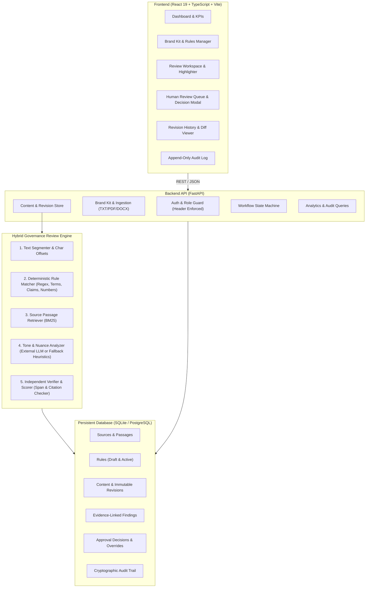
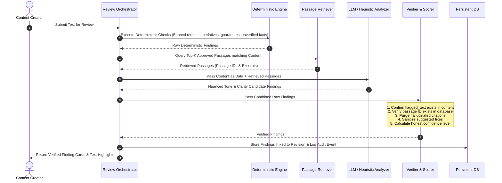
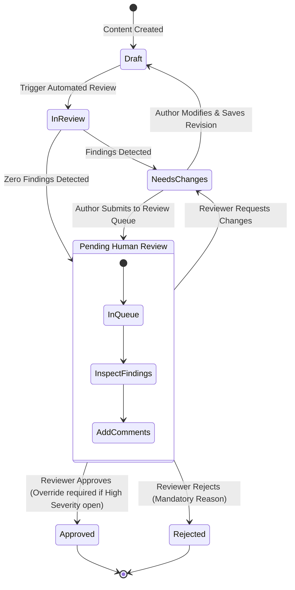
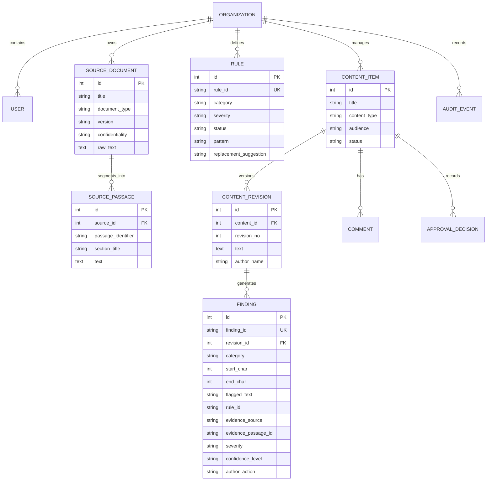

# BrandGuard AI — System Architecture & Technical Specifications

**Team Dashing Cars** | Inkloom AI Hackathon Round 2

---

## 1. High-Level Architecture Overview

BrandGuard AI is architected as an explainable, human-governed brand compliance platform. It bridges the gap between static brand guideline PDFs and dynamic content publication by evaluating marketing, social, and product copy against versioned approved sources, registered claims, and verified corporate facts.

---

## 2. Review Pipeline Execution Flow

Every review request undergoes a strict 5-stage pipeline:

---

## 3. Workflow State Machine & Human Control Points

BrandGuard AI strictly enforces that **AI can only recommend; only humans can decide.**

### Critical Human Oversight Rules:
1. **Approval Privilege**: Only users in the `reviewer` or `admin` role can approve or reject. The API rejects approval requests from other roles with `HTTP 403 Forbidden`.
2. **High-Severity Approval Block**: If open high-severity findings exist on the active revision, the backend rejects the approval with `HTTP 400 Bad Request` unless the reviewer explicitly supplies a written `override_reason` (minimum 10 characters).
3. **Auditability of Overrides**: Every high-severity override is logged as a dedicated `high_severity_override` event in the append-only audit trail.
4. **Mandatory Dismissal Justification**: Authors cannot silently dismiss findings; a written explanation is required for audit compliance.
5. **Brand Manager Rule Gate**: Extracted or drafted rules remain in `draft` status (inactive) until explicitly approved and activated by a Brand Manager.

---

## 4. Entity-Relationship Data Model

---

## 5. Security, Privacy & Integrity Safeguards

1. **Prompt Injection Resistance**: Content submitted for review is never concatenated into system instructions. Prompts explicitly wrap input as raw untrusted data.
2. **Provider Agnostic Design**: If no external LLM API key is present, the system defaults to an in-memory deterministic tone heuristic engine. The platform never crashes, hangs, or fabricates AI presence.
3. **Zero Data Retention in Model Providers**: Uses standard zero-retention API endpoints.
4. **Append-Only Auditing**: Audit records can be created through normal application interfaces but cannot be mutated or deleted.
